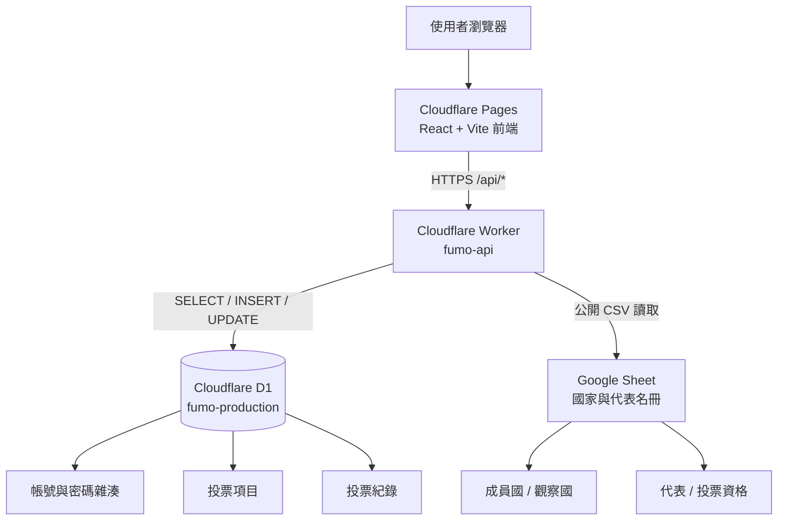

# FUMO 官方網站架構

## 1. 整體架構

Google Sheet 與 Cloudflare D1 分開使用：

- **Google Sheet**：管理國家、觀察國、代表及投票資格等名冊資料。
- **Cloudflare D1**：管理網站帳號、密碼雜湊、管理員權限、投票項目及投票紀錄。
- **Cloudflare Pages**：託管 React/Vite 前端。
- **Cloudflare Workers**：提供獨立 API，連接 Google Sheet 與 D1。



## 2. 各服務責任

| 服務 | 負責內容 | 不負責內容 |
|---|---|---|
| Cloudflare Pages | 前端畫面、路由、表單、API 呼叫 | 不直接連接 D1、不保存密碼 |
| Cloudflare Worker | API、權限檢查、資料整合、CORS | 不把 Google Sheet 名冊複製到 D1 |
| Cloudflare D1 | 帳戶、投票、投票紀錄、管理員權限 | 不保存國家名冊的主要來源 |
| Google Sheet | 國家、觀察國、代表、代表 ID、投票資格 | 不保存密碼、不保存投票紀錄 |

## 3. Google Sheet 分頁

| 用途 | GID |
|---|---:|
| 成員國 | `643747757` |
| 觀察國 | `1983936747` |
| 投票代表與資格 | `1885327256` |

Worker 透過 Google Sheet 公開 CSV 匯出介面讀取：

```text
https://docs.google.com/spreadsheets/d/1Iw5EY1LfFF-Ig9tJGVyWNBON20t9oE-0iFVFPPgsjk0/export?format=csv&gid=分頁GID
```

Worker 會在記憶體中快取資料約 5 分鐘，減少對 Google Sheet 的請求。

## 4. D1 資料表

### `voter_accounts`

保存網站帳戶資料：

- 代表 ID
- 代表名稱
- 國家名稱
- PBKDF2 密碼雜湊
- 管理員等級

### `votes`

保存投票項目：

- 投票名稱
- 說明
- 截止時間
- 選項
- 是否允許複選
- 是否已關閉

### `ballots`

保存投票紀錄：

- 投票 ID
- 代表 ID
- 代表名稱
- 國家名稱
- 選擇的選項
- 投票時間

## 5. 主要資料流程

### 5.1 顯示成員國

```text
瀏覽器
  → Pages 前端
  → Worker GET /api/members
  → Worker 讀取 Google Sheet 成員國與觀察國分頁
  → 回傳 JSON
  → 前端顯示
```

### 5.2 顯示投票

```text
瀏覽器
  → Pages 前端
  → Worker GET /api/votes
  → Worker 查詢 D1 votes + ballots
  → 回傳 JSON
  → 前端顯示
```

### 5.3 註冊帳戶

```text
瀏覽器提交代表 ID 與密碼
  → Worker GET Google Sheet 投票資格
  → 確認代表 ID 合法
  → Worker 使用 PBKDF2 雜湊密碼
  → Worker 將帳戶寫入 D1 voter_accounts
```

### 5.4 投票

```text
瀏覽器提交投票
  → Worker 驗證代表資格（Google Sheet）
  → Worker 驗證帳戶密碼（D1）
  → Worker 檢查投票期限與重複投票
  → Worker 將投票寫入 D1 ballots
```

## 6. API 分工

| API | 資料來源 | 用途 |
|---|---|---|
| `GET /api/healthz` | Worker | 健康檢查 |
| `GET /api/members` | Google Sheet | 成員國與觀察國 |
| `GET /api/voters` | Google Sheet | 投票代表與資格 |
| `GET /api/votes` | D1 | 投票列表 |
| `POST /api/votes` | D1 | 建立投票 |
| `GET /api/votes/:id` | D1 | 投票詳情 |
| `POST /api/votes/:id/ballot` | Google Sheet + D1 | 驗證資格並投票 |
| `GET /api/votes/:id/results` | D1 | 投票結果 |
| `POST /api/auth/register` | Google Sheet + D1 | 註冊帳戶 |
| `POST /api/auth/login` | D1 | 登入 |
| `POST /api/auth/change-password` | D1 | 修改密碼 |

## 7. 部署架構

### 前端：Cloudflare Pages

```text
GitHub: pengjun0429/official-website
Root directory: 留空
Framework preset: Vite
Build command:
pnpm install --frozen-lockfile && PORT=4173 BASE_PATH=/ pnpm --filter @workspace/fumo-website run build

Output directory:
artifacts/fumo-website/dist/public
```

環境變數：

```text
VITE_API_BASE_URL=https://fumo-api.micronationfumo.workers.dev
```

### 後端：Cloudflare Workers

```text
GitHub: pengjun0429/official-website
Root directory: artifacts/api-worker
Build command: pnpm install --frozen-lockfile
Deploy command: pnpm run deploy
Preview command: pnpm exec wrangler preview
Worker name: fumo-api
```

### 資料庫：Cloudflare D1

```text
Database name: fumo-production
Database ID: 12d68b57-505d-40e9-8581-5024867dbb01
Worker binding: DB
```

## 8. 安全原則

1. Google Sheet 只保存公開或半公開的名冊資料，不保存密碼。
2. 密碼只保存於 D1 的 PBKDF2 雜湊，不保存明文密碼。
3. 前端不直接連接 D1，所有資料操作必須經過 Worker API。
4. Worker 驗證代表資格時，以 Google Sheet 為準。
5. Worker 驗證已註冊帳戶、密碼及投票紀錄時，以 D1 為準。
6. Google Sheet 內容更新後，Worker 最多約 5 分鐘會讀到新資料，因為 Worker 有快取。
7. 若要完全避免名冊被公開讀取，應改用受保護的 Google Sheets API；目前架構使用公開 CSV 匯出，因此該分頁必須允許公開讀取。

## 9. 一句話總結

> **Google Sheet 管名冊，D1 管交易資料，Worker 做中介與權限驗證，Pages 管前端網站。**
